# 🧭 Astrolabe

A Claude Code mod that shows where your Spec Kit work stands and keeps your session under
its usage limits: a phase rail above the prompt, the next command to run, the task in
progress, a pane with every feature, toasts when something changes, buttons that install
updates, and a status entry with your fullest usage window.


> **Version 0.135.0.** Every image in this README is a capture of the real mod running in Claude
> Code 2.1.292, made with `scripts/capture/scene.sh` in the demo project
> [docs/demo/](docs/demo/) (see [How the images are made](#how-the-images-are-made)).

## At a glance

| Where | What Astrolabe draws | Section |
|---|---|---|
| Above the prompt | The active feature, the six Spec Kit steps, a progress bar, and buttons for updates | [The band](#what-the-band-shows) |
| Under the prompt | `◆ 002 · implement 45% │ 5h 42%`: feature, phase, progress, usage window | [The status entry](#what-the-status-entry-shows) |
| The hint line | `next: /speckit-implement · 11 tasks left` | [The prompt hint](#what-the-prompt-hint-shows) |
| The spinner | `… T011 · Show an empty-cart message · 1s` while Claude works on the feature | [The spinner](#what-the-spinner-says) |
| `/astrolabe` | A pane with Specs, Tasks and Session tabs | [The pane](#the-astrolabe-pane) |
| Toasts | A task ticked with no code edited; a phase finished | [Toasts](#toasts) |
| Tool calls | New subagents capped or held, the session paused near the limit | [Usage governance](#usage-governance) |

## Why "Astrolabe"

An astrolabe is a handheld instrument that astronomers and navigators used for centuries.
You sight a star or the sun through it, read how high the body stands above the horizon,
and from that one reading work out the time of day and where you are. Its front plate,
the rete, is a rotating map of the sky laid over the fixed coordinates of one place.

The mod does the same job for a coding session. It reads altitude: how full the context
window is, and how far the 5-hour and weekly usage windows have climbed. It turns those
readings into time: when each window resets and, at the current burn rate, when you would
reach 80%. It gives your position: the directory, branch and pull request, and which Spec
Kit feature you are in and at which phase (specify, clarify, plan, tasks, implement).

Navigators also steered by the astrolabe, and the mod acts on its readings too. When a
usage window gets high it slows down or queues new subagent dispatches, and it resumes
them after the reset.

The emoji is 🧭 because Unicode has no astrolabe. The compass is the closest navigation
instrument it offers, and the repository, the mod and its messages all use it.

## Install

You need Claude Code 2.1.292 or later (`claude --version`). In a Claude Code terminal
session, type:

```text
/plugin install astrolabe --marketplace jonyfs/astrolabe
```

Claude Code asks `Add marketplace?`. Answer `y`, pick the user scope with Enter, and you
see `Installed astrolabe. Plugin is now active.` The status entry appears in that same
session, with no restart. To check it from a shell:

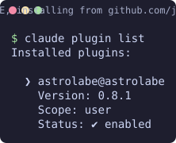

The two-step form does the same thing:

```text
/plugin marketplace add jonyfs/astrolabe
/plugin install astrolabe@astrolabe
```

From a shell it is the same two commands (a real capture, on a machine where Astrolabe was not
installed):

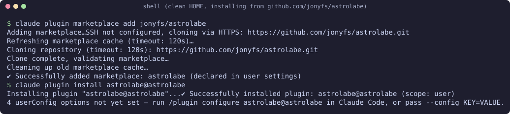

The four options start unset, which means their defaults (see [Options](#options)).

Installing changes no settings file by itself. Claude Code records the plugin and its
marketplace in `~/.claude/settings.json` (`enabledPlugins` and `extraKnownMarketplaces`),
the same as for any plugin, and the mod never writes there.

### Update and uninstall

```sh
claude plugin update astrolabe@astrolabe
```

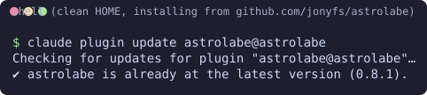

Then type `/reload-plugins` in a running session, or start a new one. Astrolabe also checks
for its own new release once a day and offers a button for it (see
[Update notices](#update-notices)).

```sh
claude plugin uninstall astrolabe@astrolabe
claude plugin marketplace remove astrolabe
```

### Install from a local clone

An install read from a folder runs the code on disk, but a session keeps the module it loaded.
With `autoReload` on (the default), Astrolabe compares the version on disk with its own after
each turn and runs `/reload-plugins` once when they differ, so a pull or a new release loads by
itself. The first version with this check needs one `/reload-plugins` of your own.

To try a working copy, add the folder as a marketplace. Claude Code then reads the plugin
from that folder, so edits show after `/reload-plugins`:

```sh
git clone https://github.com/jonyfs/astrolabe ~/src/astrolabe
claude plugin marketplace add ~/src/astrolabe
claude plugin install astrolabe@astrolabe
```

For a one-off session without installing, run `claude --plugin-dir ~/src/astrolabe`.

## What the status entry shows

Astrolabe adds one entry to the status line under the prompt. Claude Code puts the mod's
name in front of it. With the footer in the pane (`footerIn=pane`, the default) the entry is the
lead and nothing else: the feature, its phase and percentage, and the window that decides.

```text
  ⚠ astrolabe: ◆ 002 implement 45% │ 7d 81%▴ hold · Mon 07:00
```

It follows the band's tiers. From 144 columns it is the line above. At 100 columns the phase
takes its short form and the reset goes (`◆ 002 impl 45% │ 7d 81%▴ hold`); below 100 the phase
goes too (`◆ 002 45% │ 7d 81%▴ hold`). The id and the deciding window are never dropped. With
`footerIn=status` or `both` the whole footer draws here, in the form the table describes, from
left to right:

| Part | Example | What it means |
|---|---|---|
| `⚠ astrolabe:` | | Drawn by Claude Code, not by the mod. It marks a line that a mod wrote, and it names the mod. |
| `◆` | | The Spec Kit marker. Every Astrolabe entry starts with it. |
| Feature id | `001` | The three-digit number of the active feature, from its folder name `specs/001-core-state/`. The Spec Kit part is at most 68 characters with the `⚠ astrolabe:` prefix, and the usage part adds at most 18 more, so it fits whole at 100 columns and wider; Claude Code cuts what does not fit. |
| `~` before the id | `~002` | The feature was guessed. `.specify/feature.json` exists but is broken or points at a folder that is not there, so Astrolabe fell back to the git branch or the newest open feature. Fix or delete `feature.json` and the `~` goes away. |
| Phase | `implement` | The first Spec Kit step this feature has not finished. See [Phases](#phases). |
| Percentage | `87%` | Ticked tasks out of all tasks in the feature's `tasks.md`, rounded down. 43 of 49 is `87%`. It appears only once `tasks.md` has tasks. |
| Running step | `· plan…` | A Spec Kit skill such as `/speckit-plan` was called during this turn. It disappears when the turn ends. |
| Usage window | `│ 7d 81%▴ hold (Mon 14:00)` | The window that decides, its mark (`▵` from 60%, `▴` from the window's hold level, 80% by default), its band when it is not ok, and when it resets: a countdown such as `2h13m` when the reset is less than a day away, else the weekday and time. A window at or past 100% reads `full`. The other window follows. See [Usage governance](#usage-governance). |
| Context | `│  61%` | How full the context window is. Past 85% it reads `86% compact soon`. |
| Model and effort | `│  opus 5.5 high` | The model and effort of Claude's last request in the main thread. With the 1M context window it reads `opus 5.5 1M`. |
| Running skill | `│ ⟳ implement · sonnet 5.5` | The Spec Kit or gstack skill running now, with the model `skillModels` picked for it. |
| Git | `│  main ↑2  3` | The branch, commits to push and to pull, and changed or untracked files, from one `git status` at the end of each turn. Without a repository it is left out. |
| Burn rate | `│ 🔥 12/h → 96%` | Usage points an hour over the session, and where the window that decides will be at its reset at that pace. It shows once the session has two readings that rise. |
| Duration | `│  1h05m` | How long the session has run, from its first minute on. |

### One vocabulary on every surface

The band, the status entry, the footer, the spinner, the pane and the toasts share one set of
marks, formats and keys, so a value reads the same wherever it appears.

| What | Rule | Example |
|---|---|---|
| Usage level | One ramp for context, 5h, 7d and the spend limit. Below 60% no mark and the done colour; from 60% yellow with `▵`; from the window's hold level (80% by default) the blocked colour with `▴`; at 100% or more the figure reads `full`. A threshold set in `governThresholds` moves the ramp of that window. | `5h 42%`, `5h 72%▵`, `7d 81%▴ hold`, `7d full▴ ceiling` |
| Muted text | The `faint` colour role, at least 4.5:1 on the flavor's base in all five flavors. The dimmer `pending` role draws only rules, separators and glyphs. | abandoned rows, the legend, loading rows |
| State glyphs | One cell wide in every icon set, so a row never shifts when its state changes: `‖` paused, `◷` time running, `▲` warning. | `▸ T010 Write x.ts                    ◷ 12m` |
| Ids | A task id is shown as written in `tasks.md` (`T011`). Feature ids are padded with spaces to the widest id in the project, 3 or 4 digits, and are never cut: the name is cut first. | `◐ 002  band-hint`, `◐ 1000 long-name` |
| Durations | `40s`, `4m12s`, `2h09m`; whole minutes drop the zero seconds (`4m`); unknown is `?`. A reset under a day counts down; beyond a day it names the weekday and time. | `2h09m`, `Thu 18:00` |
| Phases, when room is short | `spec`, `clar`, `plan`, `tasks`, `impl`. | `◆ 002 · impl 45%` |
| Keys | `r` refresh, `q` run a queued subagent (the first queued run takes `q`), `?` help (pressed as `h`), `/` filter (pressed as `f`), `c` clear, `o` order, `p` priority, `a` advisor, space page, Esc close. | `? help (h)`, `/ filter (f)` |
| Messages | Toasts start with `astrolabe ✓` for a state or success and `astrolabe ▲` for a warning. | `astrolabe ✓ 002 band-hint moved to tasks · next: /speckit-tasks` |
| Separators | `│` between zones, `·` inside one, never both in one zone. In the footer each chip is a zone. | `◆ 002 · implement 45% │ 5h 92%▴ ceiling · paused until 14:00` |

### The footer is statusline itself

Astrolabe bundles the [statusline](https://github.com/jonyfs/statusline) project under
`vendor/statusline/` and, by default, lets it draw the pane footer. Astrolabe keeps its own lead
on the first row (the Spec Kit part, the window that decides, the advisor, the help hint) and
statusline's lines go below it, with its segments, ranks, colours, shedding and links:

```text
◆ 002 · implement 45% │ astrolabe 0.135.0 │ /astrolabe help
 ⌂ astrolabe  jonyfs/astrolabe  ⎇ 070-statusline-dependency  ●3 +7  PR #160 draft  ✓ CI
 ◆ 059 specify  ❖ humanizer, dataviz  ▸ Fix authentication (1/3)  ● working
 opus 5.5 · high  ctx 41%  5h 72%▵ · 2h09m  7d 84%▴ · Thu 18:00  cache warm · 1m  1h12m
```

It needs Node 18 or newer. Without it, with a missing copy, with the `colorblind` flavor (statusline
has none) or when the renderer fails, the footer is Astrolabe's own and the Setup tab says why.
`footerSource` picks the source:

| Value | The pane footer is |
|---|---|
| `statusline` (default) | Astrolabe's lead and the bundled statusline's lines |
| `native` | Astrolabe's own chips (specs 041, 064, 068) |

What you give up with `statusline`: the hover explanation rows, the brighten-on-change rule, the
`full` text of a cut chip and the governor's colour levels (statusline's own are 60 and 85
percent; the governor still acts at 60, 80 and 88). Its links (branch, pull request, repository,
CI) stay. The status entry under the prompt is always Astrolabe's own one line.

**Updates.** There is no download at run time. A workflow refreshes `vendor/statusline/` weekly
through a pull request, runs a contract test against it, and the copy ships with the next
release; the Setup tab shows the version and commit in use.

**What it does on your machine.** statusline writes its caches under `~/.claude/statusline/` and
starts `git`, `gh` and `rtk` probes in detached processes to fill its pull request, CI and
savings segments, as it does when it is Claude Code's `statusLine`. Astrolabe turns its own
update check off and sends it only the session figures it has (model, context, usage windows,
folder), so segments that read the transcript (skills, todo, working) appear only where the
engine hands that path over.

**Use it as Claude Code's own statusLine.** `/astrolabe statusline` prints the command for the
bundled copy and the line to put in `settings.json`; Astrolabe never writes it:

```text
> /astrolabe statusline
statusline 1.46.0 (b703d7b) is bundled with Astrolabe.
Command: node "/home/you/.claude/plugins/astrolabe/vendor/statusline/bin/cli.js"
{
  "statusLine": {
    "type": "command",
    "command": "node \"/home/you/.claude/plugins/astrolabe/vendor/statusline/bin/cli.js\""
  }
}
```

### The footer in place of a statusline

The footer carries what a statusline under the prompt usually shows, so you can remove a
separate `statusLine` command from your settings. By default it sits at the bottom of the
`/astrolabe` pane, under every tab, and the status entry keeps only the Spec Kit part and the
window that decides (`◆ 002 · implement 45% │ 5h 42% (2h13m)`). Set `footerIn` to `status` to put
the whole footer back in the status entry, or `both` for both places. On a tab shorter than the
pane the footer holds the last rows; the Dashboard is longer, so its footer follows the charts.

In the pane the footer is drawn the way the [statusline](https://github.com/jonyfs/statusline)
project draws its bar: Powerline chips in Catppuccin colours. Spec Kit is mauve, the model red, git
lavender, and the usage windows and the context follow statusline's ramp: green below
60%, yellow from 60% to 80% (`5h 72%▵`), red from 80% (`5h 94%▴`), where 80% is the window's hold level. The context takes the colour without the
mark. The `flavor` option picks the palette; with `ascii` icons, the accessible mode or the
`NO_COLOR` environment variable set, the footer is plain text with ` │ ` between the parts.

With `footerLines` set to `3` the footer draws statusline's three lines, each chip its own zone:

```text
⌂ astrolabe │ jonyfs/astrolabe │ git:063-statusline-parity │ ~3 ✖2 ⇡2 ⇣5 │ +156 −23 │ PR #41 draft · ux │ ✓ CI
◆ 059 · specify │ ❖ humanizer, dataviz, mermaid +2 │ ▸ Fix authentication (1/3)
opus 5.5 · high · fast │ ctx 41% │ 5h 72%▵ (2h09m) │ 7d 84%▴ (Thu 18:00) │ cache warm · 1m │ ⇡ 9%/h │ 5h limit ~16:40 │ t 1h12m
```

Line one is the place and git, line two the work, line three the model and the limits. Each part
appears only when it has something to say:

- `✖2` counts merge conflicts apart from `~3` changed files. `⇡2` and `⇣5` are commits ahead of and
  behind the upstream, and show only when the branch has one. A detached HEAD shows its short
  commit id, and a linked worktree shows the branch of the main checkout it came from.
- The directory follows Claude: `⌂ src ⇐ astrolabe` after it moved from the folder the session
  started in.
- `PR #41 draft · ux` carries the pull request's draft state and first labels. `✓ CI`, `✖ CI` or
  `◷ CI` is the last run of the current branch. Both need the `pullRequest` option and `gh`.
- `❖ humanizer, dataviz +2` is the skills used in this session, five names and then a count. The
  todo chip `▸ Fix authentication (1/3)` is the todo list's current item and its progress.
- `fast` follows the effort while fast mode is on. It shows only when the model request says so
  (`speed: fast`); a session whose requests do not name it never shows the chip.
- `⇡ 9%/h` is the burn rate, shown after five usage readings over at least a minute.
  `5h limit ~16:40` is the projection and shows only when the window would fill before it resets.
- The cache chip is silent while the prompt cache has time to spare. It reads `cache warm · 1m` in
  the last two minutes of a five-minute cache, and `cache cold · 182k` once it expired, with
  `· model changed` when a model switch caused it. It rests on the usage of each answer; the
  engine gives a mod nothing else about the cache, so a cache Astrolabe never saw answer shows no chip.

A branch, PR, skills or model chip that changed draws a shade lighter for 30 seconds. Usage chips
never do. Point at a chip and a row under the footer explains it in one sentence:
`↳ The prompt cache: warm means the next prompt reuses it; cold means ...`. With the `ascii` icon
set the marks above become `dir`, `<-`, `^`, `v`, `!`, `ok`, `..`, `*` and `>`.

When the room is too narrow, chips go in this order: the version and help hint, repository name, duration, lines changed,
projection, CI, PR, burn rate, advisor, the tree counters and the cache. The context, branch,
directory, 5h and 7d windows and the model stay. The Spec Kit part and the window that decides
always stay.

| A statusline showed | In Astrolabe |
|---|---|
| Directory, repository, branch, ahead and behind, changed files, conflicts, stashes, worktree | Line one of the footer |
| Model, effort, fast mode, context window | Line three |
| 5-hour and 7-day windows with their resets | Line three, and the governor acts on them |
| Session duration | Line three (Astrolabe shows no cost: on a subscription it means nothing) |
| Burn rate and projection | Line three, and the Dashboard tab |
| Todo progress, Claude working or idle | Line two, the band, the spinner and the Tasks tab |
| Skills in use | Line two, with the running Spec Kit skill in the band |
| Pull request, draft state and last CI run | Line one with the `pullRequest` option on |
| Prompt cache timer | The cache chip, and a toast 30 seconds before the cache goes cold (see [Toasts](#toasts)) |
| Vim mode, rtk savings | Left out |

The git part reads like this with `icons` set to `ascii`:

```text
git:023-git-footer │ ~3 ^2 │ stash:1 │ wt:review │ PR #32 ok
```

`~3` and `^2` are changed files and commits ahead, `stash:1` is one stash entry, and `wt:review`
says the checkout is the linked worktree `review`. `PR #32 ok` is the branch's open pull request
with every check passed; `x` means one failed and `..` that some are still running. The pull
request part needs the `pullRequest` option and the `gh` command, signed in. Astrolabe asks `gh`
at most once every five minutes per branch, on a timer after the turn, so a slow network never
holds the footer. Without `gh`, or with no pull request for the branch, the part is left out.

Icons follow the `icons` option: Nerd Font glyphs in the terminal and emoji in the Desktop app by
default, or `ascii` for plain characters everywhere. A Nerd Font cannot be detected, so pick
`emoji` or `ascii` if the glyphs show as boxes.

The other entries you may see:

| Entry | When |
|---|---|
| `◆ no Spec Kit` | No folder from the session's directory up to the filesystem root holds a `.specify/` directory. Nothing else is read. The band only shows update buttons, if any (image below). |
| `◆ no active feature · next: /speckit-specify` | Spec Kit is set up, but every feature is done or abandoned, or there are none yet. The command after `next:` is the one to run. |
| `◆ no active feature · next: /speckit-constitution` | Same, and the constitution is missing or still the unfilled template. |
| `◆ 003 · abandoned` | `feature.json` names a feature whose spec says `status: abandoned`. A percentage follows when it has tasks (`◆ 003 · abandoned 40%`). |
| `◆ 001 · done 100%` | `feature.json` names a finished feature. Run `/speckit-specify` for the next one. |
| `… │ 5h 42%` | The fuller usage window, with its mark and band when it is not ok (`5h 83%▴ hold`). See [Usage governance](#usage-governance). |

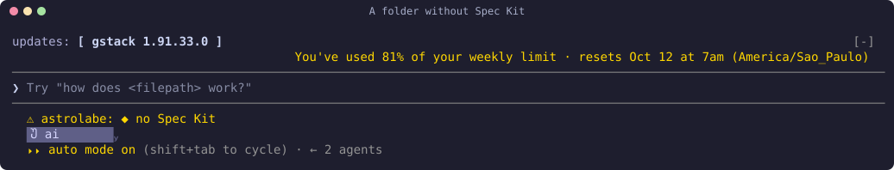

### Phases

The phase is read from the files on disk, top to bottom; the first rule that matches wins.

| Rule | Phase | What to run next |
|---|---|---|
| `spec.md` front matter says `status: abandoned` | `abandoned` | `/speckit-specify` for a new feature |
| `spec.md` front matter says `status: done` | `done` | `/speckit-specify` |
| No `spec.md` | `specify` | `/speckit-specify` |
| Front matter says `track: quick` | `implement` | `/speckit-implement`, until you set `status: done` |
| No `plan.md`, and `spec.md` still has `[NEEDS CLARIFICATION` | `clarify` | `/speckit-clarify` |
| No `plan.md` | `plan` | `/speckit-plan` |
| No `tasks.md`, or no tasks in it | `tasks` | `/speckit-tasks` |
| Some tasks open | `implement` | `/speckit-analyze` before the first tick in a session, then `/speckit-implement` |
| All ticked, front matter says `status: active` | `implement` (100%) | Set `status: done` when you agree it is finished |
| All ticked | `done` | `/speckit-specify` |

### When it updates

Astrolabe reads every feature once when the session starts. At the end of each turn it
re-reads `feature.json`, the constitution, the `specs/` listing, the active feature, and any
other feature a tool touched during the turn, so a box you tick in another editor shows up
when the next turn ends. While a turn runs, an edit or write by Claude to `spec.md`,
`plan.md` or `tasks.md` updates the entry right after that tool call.

A project with 40 features costs one full read per session and a handful of file reads per
turn.

## What the band shows

The band is one row directly above the prompt (the first row in the image at the top). At 200
columns, with the 9th of 20 tasks of feature 002 in progress:

```text
 002  shopping-cart  ✓ specify ✓ clarify ✓ plan ✓ tasks  ▶ implement 9/20  █████████░░░░░░░░░░░ 45%  │ ▸ T011 Show an empty-cart message · 4m   ≡ a [ ⬆ gstack 1.91.33 ] [ ✕ ]
```

| Part | Example | What it means |
|---|---|---|
| Id chip | ` 002 ` | The active feature, from `specs/002-band-hint/`, as a chip. A `~` before the id means the feature was guessed. It opens `spec.md`. |
| Name | `shopping-cart` | The feature's name in bold. A `+2` after it counts the other features in progress, and `⑂ name` names the linked worktree this session runs in. |
| Finished steps | `✓ specify ✓ clarify ✓ plan ✓ tasks` | Each step already done. A click opens the step's file (`spec.md`, `plan.md`, `tasks.md`). The constitution step appears only while the constitution is not ratified. |
| Current step | ` ▶ implement 9/20 ` | The step the feature is in, as a peach chip holding the ticked and total tasks. With open questions left after the plan it is a red ` ? clarify 2 ` chip. A quick-track spec (`track: quick`) shows `✓ spec ✓ tasks` and ` ▶ impl 3/5 `. |
| `…` after the chip | `▶ plan …` | A Spec Kit skill for that step is running in this turn. |
| The bar | `█████████░░░` | One cell per tenth of the tasks ticked at 100 columns, 13 cells from 144, 20 from 200. Green from two thirds ticked, peach from a third, red before that. |
| The percentage | `45%` | Ticked tasks out of all, rounded down, from 144 columns. Below that the chip's count says it. |
| The task | `│ ▸ T011 Show an empty-cart message · 4m` | The first open task, its text from 144 columns and how long it has been current from 200. |
| Counts | `3 agents · 3 gates` | How many subagents and git gates are live. Names are in the live table, not here. |
| Buttons | `≡ a`, `[ ⬆ gstack 1.91.33 ]`, `[ ✕ ]` | Open the pane (`a` once the band has the keyboard, from 100 columns); one update button, or `⬆ 2` for two or more, which opens the list in the pane's Session tab; hide the update button. |

With the governor at its pause level the task is replaced by a red `‖ paused until 07:00` and a
`lift 1h` button; at hold it reads `‖ holding new subagents`.

With the pointer on a step name, a card under the band says what the step is for and how many
features are in it (`plan: the technical plan, research and data model · 2 features here`).

A finished feature reads ` ✓ done `. An abandoned feature named by `feature.json` shows
` 003  name  abandoned` instead of the rail.

The band follows one drop order as the terminal narrows and never cuts the id, the current step,
its count or (in the status entry) the deciding window: the task's title, then the step names (the
`✓` marks stay), then the feature name, then the bar and percentage, then the update label (`⬆1`).
At 144 columns the percentage and the cut title are still there, at 100 the steps are marks
(`✓✓✓✓`), at 80 the row is the id, the marks, the chip and the task id:

```text
 002  ✓✓✓✓  ▶ implement 9/20  │ ▸ T011                                  ⬆1
```

The `bandDensity` option starts lower: `compact` at the 100-column row, `minimal` at the 80-column
row at any width. After ten minutes with nothing running and nothing typed, the band is that
80-column row, dimmed, with the deciding window (`7d 81%▴ hold`) at its end; the next activity
brings it back.

Under the `compact` preset a finished phase brightens its step chip for 30 seconds instead of
raising a toast. The `full` preset keeps the toast.

The next command is not on the band: see [The next command](#the-next-command). In a 100-column
terminal the band looks like this:

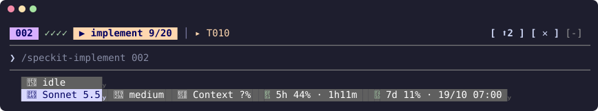

The band shows nothing of its own when the project has no Spec Kit, when no feature is active
(the prompt hint then names the command to run), or while a survey uses the band. Whatever
other mods draw there stays.

## What the live table shows

One table sits above the prompt, under the band, for everything that is running or about to bite: subagents, git gates, the prompt cache and the usage limits. It draws nothing when nothing is live.

```text
  WHO        WHERE   WHAT                         NOW     LEVEL           SIZE TIME
◇ opus       Explore Review the spec              reading ▰▰▰▱▱▱▱▱▱ 33%    12k 4m12s
◇ sonnet     Plan    Write the tests                                            40s
─
⛭ pre-commit *       gates.sh › review.test.sh    running                       14s
─
◌ cache      5m      the next message rewrites it cold    ▱▱▱▱▱▱▱▱▱ 0%   182k
─
◔ 7d                 new subagents wait           hold    ▰▰▰▰▰▰▰▱▱ 81%▴       Wed 12:00
```

A real capture of a gate running, at 180 columns and at 100 (the table drops NOW, SIZE and TIME):

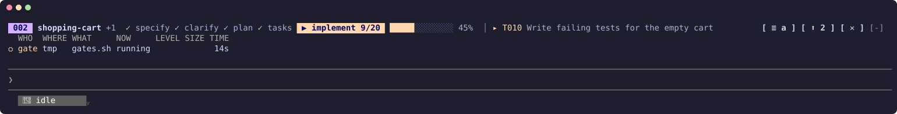

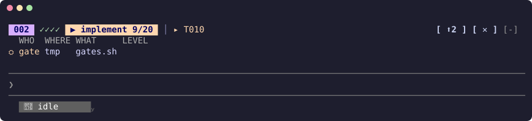

Rows group as agents, gates, cache, limits, three of each at most and then `+N`; the Session tab
lists every live row. A cell a kind has nothing for stays blank, never `0`. A column keeps the
width it first needed for the rest of the session, so rows do not jump.

| Kind | WHO | WHERE | WHAT | NOW | LEVEL | SIZE | TIME |
|---|---|---|---|---|---|---|---|
| `◇` agent | opus, sonnet, haiku | agent type, blank when two share it | the brief | the step, when the engine reports one | context gauge | tokens | age |
| `⛭` gate | the hook, or `gate` | worktree, `*` for yours | chain of programs | `running`, or `waiting for gates.lock` in yellow | blank | blank | age |
| `◌` cache | `cache` | 5m or 1h | what the next message does | `warm` or `cold` | time left | tokens to rewrite | expires in |
| `◔` limit | 5h, 7d | blank | the governor rule in words | `cap`, `hold` or `pause` | usage gauge with the ramp marks | blank | reset |

Agent rows come from the requests and the end of a subagent's own turn. In Claude Code 2.1.296 a
mod receives no event for a subagent that the Agent tool launches, so the agent rows stay empty
there and the capture above shows a gate only; they fill when the engine reports a subagent.

The cache row shows in the last two minutes of a five-minute cache (ten for an hour) and once it
is cold. A limit row shows from 60%.

**Gates.** Astrolabe reads the process list, at most every 15 seconds, while a command that may
run a git hook (`git commit`, `git push`, merge, rebase, cherry-pick) or a gate script is running,
and for as long as a gate is seen. A hook shows as one row whose chain holds the scripts it ran.
A script is a gate when its name starts with `gate` or `gates` and `-`, `_` or `.`, or when it sits
in a `gates/` folder, or when it matches `gates.patterns` of the project's `.statusline.json`.
A pid named in `gates.lock` at the repository root or in `.git/` reads as waiting. One toast
appears when a `git commit` or `git push` fails within a minute of a gate being seen. A hook that
a terminal outside Claude Code starts is not seen.

**Narrow widths.** The table drops SIZE, then TIME, then NOW, then WHERE; WHO, WHAT and LEVEL stay.
On a short window the gate rows go first, then the agent rows, before any footer line; the band
keeps the counts.

The `liveRows` option picks `agents`, `gates`, `both` (default) or `off`. It covers the agent and
gate rows; the cache and limit rows follow their own rules above.

## What the spinner says

While a turn works on the active feature, the spinner line names the task in progress and how
long it has been the current one:

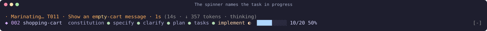

Claude Code still draws its own word and, after Astrolabe's part, the turn's time and token
count. Astrolabe only adds the part after the word:

| Part | What it means |
|---|---|
| `T011` | The id of the first open task in the active feature's `tasks.md`. |
| The text | The task's text without the `[P]` and `[US1]` markers or backticks, cut with `…` when the terminal is narrow. The id is never cut. |
| `1s` | How long this task has been the first open one, counted from when Astrolabe first saw it this session: `45s`, `12m` or `1h 5m`. |

It shows only during a turn that works on the active feature, meaning `/speckit-implement` was
called, or Claude read or edited a file in the feature's folder during the turn. A read counts
from the moment it starts, so the narration shows early in a short turn. Other turns keep the
plain spinner. When Claude Code shows its own message on the spinner (while compacting, for
example), that message wins.

## The next command

The next Spec Kit command lives in one place at a time. While the prompt is empty, it is
proposed in the prompt box: press Tab (or the right arrow) to take it, then Enter. Once you type,
the prompt hint under the box shows it instead (`next: /speckit-implement · 11 tasks left`), so
you never see both at once. Each time the next command changes it is proposed again.
`/astrolabe next` runs it from the prompt, and `/astrolabe` opens the pane, whose Specs tab has
a button for it on the selected spec. When the last task of a feature is ticked, the prompt box
proposes a retrospective instead: `/speckit-retro` when the project has that skill in
`.claude/skills/`, gstack's `/retro` otherwise. The `minimal` preset shows none of this.

The band no longer carries a next-command row or the `n` and `c` keys. Its buttons are `a`
(open the pane), the update button and hide.

### Acting on a spec

`/astrolabe priority 3 high` (or `normal`, `low`) orders a spec within its section of the Specs
tab: high ones first with `↑` before the id, low ones last with `↓`. On the Specs tab, `p`
cycles the active spec through normal, high and low. Priorities are kept per project in
Astrolabe's own store; nothing is written in the project.

`/astrolabe review` (or `/astrolabe review 3`) sends the spec's `spec.md`, `plan.md` and
`tasks.md`, with the names of the constitution's principles, to a stronger model (`opus`, effort
`xhigh`) and asks for at most 10 findings: what is missing, ambiguous, inconsistent or risky.
The answer lands in the Session tab under `review`, and a toast says when. Only you can start
it, by typing the command, since it costs that model's tokens.

`/astrolabe advisor` (or `/astrolabe advisor 3`) asks Claude to review the spec with its advisor:
Claude reads `spec.md`, `plan.md` and `tasks.md`, calls the advisor, reports what it finds and
proposes changes without editing anything. A mod cannot call the advisor itself, since the API
runs it inside Claude's own request, so this takes one turn. The `advisor review` button on the row
under the selected spec does the same for that spec, and the Session tab counts the advisor's runs this
session. When that turn ends after the advisor ran, the Session tab also keeps Claude's report,
its first 12 non-blank lines under `advisor 002`. Only you can start it.

The advisor button asks for a second press within ten seconds (`press again: the advisor takes a
turn`), since it costs a whole turn; `a` presses it. The selected spec gets a detail line above its
buttons, for example `003 gamma · plan · 8 tasks left · 2 open questions · checklist 1/3 open · ↑ high ·
next /speckit-plan`, and a `⧉ /speckit-plan` button that copies that command.

When gstack is installed, that row also holds the skills that fit the spec's phase, not all of them
at every phase: `office-hours` and `plan-ceo-review` while specifying, `plan-eng-review` and
`plan-design-review` while planning, `review`, `investigate`, `qa-only` and `health` while
implementing, `retro` and `document-release` once done. The row sits under the spec selected in the
list, so the buttons are beside the spec they act on; a press runs that skill with that feature named
in its arguments.

The Specs filter box takes words and tokens: `phase:plan`, `has:questions`, `has:checklist`,
`has:warning`, `has:worktree`, `track:quick`, `prio:high`, `is:active` (and `is:progress`,
`is:next`, `is:done`). A muted row under the box lists the tokens and the count
(`phase:plan · has:questions 3/12 rows`). `c` clears the filter and the status, and `o` cycles the
order inside each section: file order, most done first, by name.

`/astrolabe doctor` checks what Astrolabe needs and prints the fix next to anything missing:

```text
🧭 Astrolabe doctor
  ✓ git version 2.50.0
  ✓ gh version 2.80.0
  ✗ gh not signed in: run gh auth login
  ✓ specify 0.4.2
  ✓ Spec Kit project at /proj
  ✗ Spec Kit skills 0.4.0, CLI 0.4.2: refresh the skills: specify init --here --integration claude --force
  · icons: nerd (needs a Nerd Font in the terminal; set icons to emoji or ascii if glyphs show as boxes)
  · options: all defaults (change them in /config or the Config tab)
  ✓ slowest hook work: state update, 42 ms of the 10 s budget
```

The last line times every state update since the plugin loaded and names the slowest. It turns
into a `✗` past 5 s, half of the 10 s the engine gives each hook.

`/astrolabe recap` lists the last 5 turns on the active feature, one line each: the time and the
first line of Claude's answer. `/astrolabe recap 026` does the same for feature 026. It keeps the
last 20 answers' first lines in the session's state only.

```text
Recent turns on 054:
  14:02  Done: T057 ticked, the implement guard refuses once
  14:20  Shipped v0.80.0 after the three CI jobs passed
```

`/astrolabe focus on` turns on focus mode. While it is on, the line Astrolabe adds to your prompt
also tells Claude to change only the files the current task names: backticked paths and words with a
slash or a file extension, such as `hooks/core/pane.ts` or `README.md`. A task that names no file
gets "change only what task T010 needs and no other file". `/astrolabe focus off` turns it off, and
`/astrolabe focus` says whether it is on. Only you can switch it, from the prompt; the setting lasts
for the session, across a `/reload-plugins`. It needs the `claudeContext` option on.

```text
Astrolabe: the active Spec Kit feature is 054 pane-polish, phase implement, 62 of 99 tasks done; the current task is T010 Edit `hooks/core/pane.ts`; the next command is /speckit-implement; focus mode is on: change only hooks/core/pane.ts.
```

`/astrolabe kpis` prints the Dashboard's numbers as a Markdown table you can paste into a pull
request body: the active feature's tasks, the turns, the tool calls, the pace, the burn rate and the
rest of the KPI rows the session has. Pipes in a value are escaped so the table stays whole.

```markdown
### Session numbers for 054 pane-polish

| | |
|---|---|
| tasks | 61/99 |
| turns | 42 |
| tool calls | 318 |
| session | 2h10m |
```

`/astrolabe status` prints the active feature, the next command and the footer as text, with the
band drawn above it in the terminal:

```text
◆ 002 band-hint: implement, 9/20 tasks (45%)

next: /speckit-implement

◆ 002 · implement 45% │ 5h 42% (2h13m) │ ctx 61% │ opus 5.5 high │ git:main ~2
```

When Claude ticks tasks with an Edit, the tool's row in the transcript names them
(`↳ ticked T010 task 10`).

## What the prompt hint shows

While the prompt is empty, Astrolabe adds the next Spec Kit command to the end of Claude
Code's hint line, after whatever is already there:

```text
⏵⏵ auto mode on (shift+tab to cycle) · next: /speckit-implement · 4 tasks left
```

The command is the one in the [Phases](#phases) table. In the implement phase it also counts
the tasks left. It disappears as soon as you type.

## Options

Twenty-three options appear in Claude Code's config menu (`/config`, then Astrolabe). Changing
one reloads the mod right away.

| Option | Values | Default | What it changes |
|---|---|---|---|
| `preset` | `minimal`, `compact`, `full` | `compact` | Where Astrolabe draws. `minimal` keeps only the status entry. `compact` adds the band, the prompt hint, the spinner narration and the drift alarm. `full` also opens the `/astrolabe` pane by itself on a wide fullscreen terminal, and shows phase toasts as well as the drift alarm. |
| `flavor` | `mocha`, `frappe`, `macchiato`, `latte`, `colorblind`, `theme` | `mocha` | The band palette. `colorblind` uses distinct blue, teal, amber and vermilion colors with shape marks for statuses. `theme` takes Claude Code's own theme colors, so the band and the pane follow your light or dark theme; the Dashboard charts then use `latte` on a light theme and `mocha` on a dark one. |
| `checkUpdates` | `true`, `false` | `true` | The daily update check and its buttons (see [Update notices](#update-notices)). |
| `governUsage` | `true`, `false` | `true` | Enforce usage limits (see [Usage governance](#usage-governance)); off, the windows still show. |
| `governThresholds` | JSON object | `{}` | Per-window hold/stop thresholds, overriding the defaults of the [governance bands](#usage-governance), for example `{"five_hour":{"hold":80,"stop":88},"seven_day_opus":{"hold":85,"stop":90}}`. An empty object keeps the defaults. |
| `quietHours` | `HH:MM-HH:MM` | (empty) | During quiet hours, for example `22:00-06:00`, the governor never asks: it applies the cautious answer itself (holds and pauses without asking). Empty or invalid means it always asks. |
| `observeUsage` | `true`, `false` | `false` | Log what the Governor would hold or pause without blocking tools; takes precedence over enforcement. |
| `icons` | `auto`, `nerd`, `emoji`, `ascii` | `auto` | Icons in the footer and the Dashboard. `auto` is Nerd Font glyphs in the terminal and emoji elsewhere. |
| `language` | `auto`, `en`, `pt-BR`, `es`, `fr` | `auto` | The language of the pane, the Dashboard, the governor's questions, the toasts and `/astrolabe help`. `auto` follows the language you type in, English until a prompt says enough. What Claude reads (refusals, resume prompts) stays in English. |
| `claudeContext` | `true`, `false` | `true` | Tell Claude about the Spec Kit work: one line on the active feature, its current task and the next command rides along with your prompt when it changed, and a Spec Kit skill gets the constitution's principles as a reminder. |
| `featureSummary` | `true`, `false` | `false` | When a feature's tasks are all done, ask `haiku` for a five-line summary, shown in the Session tab. It uses a little of your usage. |
| `humanize` | `true`, `false` | `false` | Add short humanizer rules to Claude's system prompt for everything it writes in the project: plain prose, no hype words, no em dashes, facts kept exact. |
| `terse` | `off`, `lite`, `full` | `off` | Ask Claude to answer briefly. `lite` keeps full sentences; `full` drops filler and articles. Files, commits and PR text stay normal prose. |
| `skillModels` | `off`, `auto` | `off` | `auto` sends each Spec Kit and gstack skill's requests with the model and effort it does best with, as the Help tab lists them (Opus for specify, clarify, plan, analyze and review; Sonnet for tasks, implement and ship; Haiku for quick reports). Switching models re-reads the context, so on a long session it costs more. |
| `accessible` | `true`, `false` | `false` | Text only, for screen readers and plain terminals: ASCII icons, charts as text, no hover styles on the band, no animated dial and no pictures. |
| `bandDensity` | `full`, `compact`, `minimal` | `full` | How much the band shows: the rail with step names when there is room, the current step and the count, or the id and the step. |
| `liveRows` | `agents`, `gates`, `both`, `off` | `both` | Which rows the live table above the prompt shows besides the cache and the limits: running subagents, git gates, both or neither. |
| `footerIn` | `pane`, `status`, `both` | `pane` | Where the footer goes: the bottom of the `/astrolabe` pane (the status entry keeps the Spec Kit part and the deciding window), the status entry, or both. |
| `footerLines` | `1`, `3` | `1` | How the pane's footer draws its chips: one row, or three in statusline's order (place and git, then the Spec Kit work and the skill, then the model and the limits). |
| `footerSource` | `statusline`, `native` | `statusline` | Who draws the pane footer: the bundled statusline under Astrolabe's lead (needs Node 18 or newer, else the native footer shows), or Astrolabe's own chips. |
| `footerSeparator` | `solid`, `thin`, `none` | `solid` | The rule above the pane's footer: a solid line, a thin one, or none. |
| `autoReload` | `true`, `false` | `true` | After a turn, when the Astrolabe on disk is newer than the one running (an install from a local clone, an update), run `/reload-plugins` once so the new version loads. Off, a toast says to run it. |
| `images` | `auto`, `on`, `off` | `auto` | Draw the Dashboard's usage chart as a picture. `auto` does on kitty and Ghostty outside tmux. |
| `pullRequest` | `true`, `false` | `false` | Show the branch's open pull request and its checks in the footer, from `gh`. See [The footer in place of a statusline](#the-footer-in-place-of-a-statusline). |
| `askOnLimit` | `true`, `false` | `true` | Before it holds a subagent or pauses Claude, the governor asks you (see [Asked when it holds or pauses](#asked-when-it-holds-or-pauses)). Off, it holds and pauses without asking. |

You can also type `/plugin configure astrolabe@astrolabe` in a session, or set them from a
shell. Options you leave out keep their values:

```sh
claude plugin configure astrolabe@astrolabe                      # show the current values
echo '{"preset":"minimal","flavor":"latte"}' | claude plugin configure astrolabe@astrolabe --values-stdin
```

Colors are sent as hex values. On a terminal without truecolor, Claude Code decides how close a
color it can show.

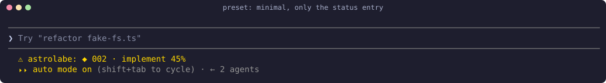

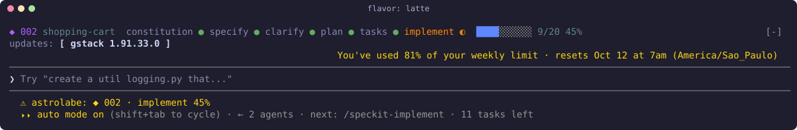

Every flavor, captured from the real mod (the capture tool draws on a dark background and tmux
reduces each colour to its nearest 256-colour match):

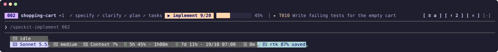
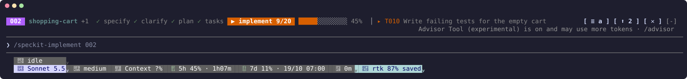
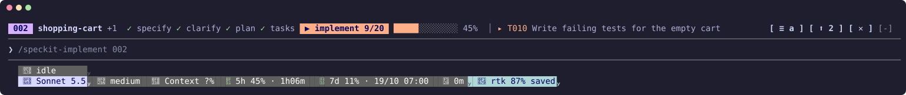

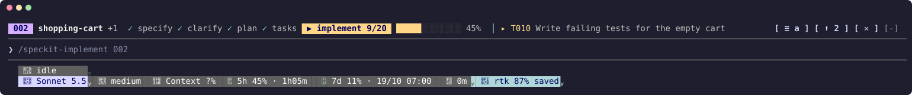
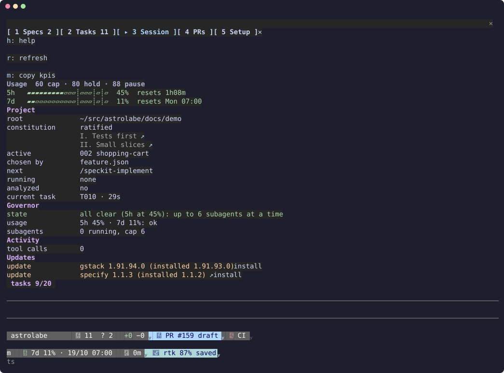
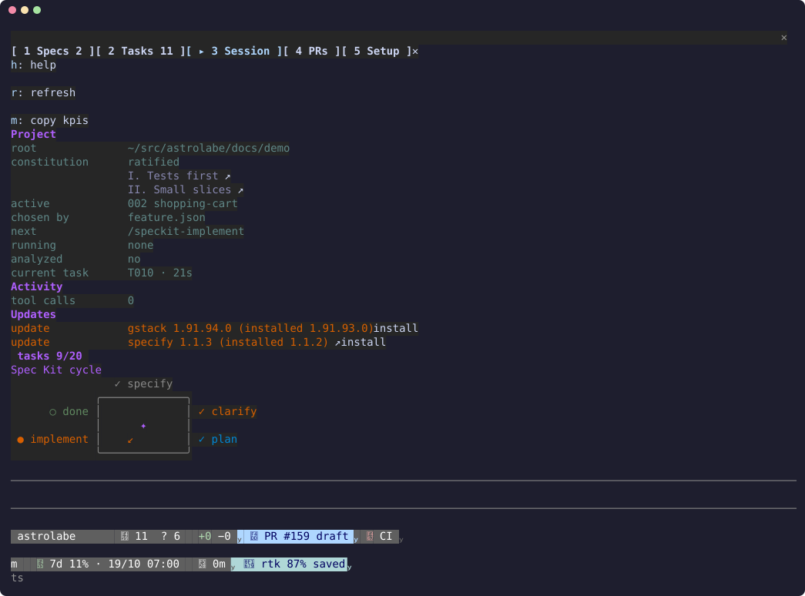

The current values, from a shell:

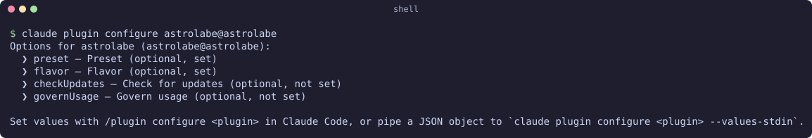

## The /astrolabe pane

The first session after you install Astrolabe shows one toast: `/astrolabe opens the pane,
/astrolabe help lists the commands`.

Type `/astrolabe` to open a pane with five tabs (`/astrolabe help` lists every command and key):

```text
🧭 Astrolabe · ◆ 002 shopping-cart · feature.json                       [ ✕ ]
 1 Specs 2   2 Tasks 11   3 Session ▲   4 PRs 1   5 Setup
 h: help  f: filter  s: in progress  o: by progress  p: priority  r: refresh
────────────────────────────────────────────────────────────────────────
```

| Tab | What it holds |
|---|---|
| 1 Specs | Every feature in sections: Active, In progress, Early, Ready to close, Next up, Done and Abandoned (the last two fold). The selected spec is a block: its row, what it needs (`11 left · ? 1 question · checklist 2 open`), the next command, copy, advisor, and gstack's skills for its phase. |
| 2 Tasks | The active feature's open tasks: a header with what is left (`002 shopping-cart · implement · 9/20 · ≈1h20m left`), a warning when open tasks pass the 5h reset, the current task bold with `◷ 4m12s` at the right edge and its files under it, each user story with its count (`US3 Cart page 0/5`), `[P]` runs as a `┐ ┤ ┘` bracket, done tasks folded. |
| 3 Session | Usage as 20-cell bars with `┊` ticks at the governor levels, the governor (state, queue with run buttons, `l` allow, `v` revoke), the project and activity rows, the updates with an install button each, then the Dashboard: dial, phases, the usage chart and the numbers. |
| 4 PRs | The open pull requests as a table: number and title (a link), draft, labels, review state and checks as `✓ ✖ ◷` cells, with approve, update and merge buttons that ask for a second press. |
| 5 Setup | Every Astrolabe option under Look, Usage governor, Claude and Integrations, then the model per skill. A value that differs from its default carries `•`, and its default shows on hover. Changes save to the mod store; nothing writes `settings.json`. |

Help is not a tab. `?` (pressed as `h`) opens it over the tab you are on, and a tab key or `h`
again closes it. A tab stored by an earlier version maps to its new tab: `dashboard` opens
Session, `config` and `models` open Setup.

In a fullscreen terminal the pane docks at the right; otherwise it sits above the prompt. It
opens with the keyboard on it, so `1` to `5` switch tabs right away, and Esc closes it. Later,
focus it again with a click or `ctrl+x tab`. The tab you pick stays for the session, and the next
session of the same project opens on it.

The second row of the pane is the tabs and nothing else. The third row holds the keys of the tab
shown, each drawn by its own button as `key: verb`: `/` (pressed as `f`) puts the cursor in one
filter that keeps the rows holding what you type (a filter that keeps nothing says so), `s` cycles
the status filter (all, in progress, next up, done, abandoned), `o` the order, `p` the priority of
the active spec, `c` clears the filter, `r` refreshes, `m` copies the Dashboard's numbers. From 80
columns the row below the body ends with `updated 14:32`, when Astrolabe last wrote what the tabs
show; `✕` closes the pane.

The pane's title names the active feature the way the band and the footer do, and why it is the
active one: `🧭 Astrolabe · ◆ 026 claude-context · feature.json` (or `branch`, or `highest open
spec`; a `~` before the id means the feature is a guess). A tab label carries a count only when
something waits on you: `Specs 3` features in progress, `Tasks 11` open tasks of the active
feature, `PRs 2` open pull requests, and `Session ▲` while the governor holds or pauses. Below 80
columns a tab shows only its number and count (`2·11`), and below 60 the Specs rows drop their
progress bars. Above the footer, a dim row says what the tab is for and lists its keys, such as
`every feature, its phase and progress · 1-5 tabs · h help · f filters · s status · j/k scroll · r ↻ · Esc closes`.
A tab with nothing to show says what would fill it and the command that does, for example
`No active feature. Run /speckit-specify to start one.`

Times in the governor rows read clock first, then the distance (`until 14:00, in 2h13m`). The footer's Spec Kit chip, when a narrow pane cuts it, shows its whole text above the row while the pointer is over it. During your first three sessions the footer also ends with a `/astrolabe help` chip, the first one a narrow footer drops. The PRs tab adds who opened each pull request and how long ago (`@jonyfs 3d`).

The Session tab's dashboard units also count subagent runs per feature (`by feature  002: 3, 001: 1`) and the share of task boxes ticked by subagents against the main thread (`ticked by  subagents 3 · main 1 (75% by subagents)`), counted from the session's Edit calls on `tasks.md` and `spec.md`.

With `skillModels: auto`, while `/speckit-implement` runs, the current task's own words pick the model: tests and mechanical work (`test`, `fixture`, `docs`, `rename`) on Sonnet, design work (`design`, `architecture`, `schema`, `data model`) on Opus. A task that says neither keeps the skill's entry.

At 140 columns and wider the status entry under the prompt shows the whole footer on one line, even when the footer sits in the pane. The prompt-cache reminder (`The prompt cache goes cold in about 30 s`) only fires when the next step is likely soon: a skill is running, or the active feature is implementing with tasks left.

`r` refreshes the pane now: it re-reads the specs, git, the worktrees, this
branch's pull request and, on the PRs tab, the open pull requests. Ctrl+R is not a key a pane
button can take, so the key is `r`. When a turn ended ten minutes ago and nothing has happened
since, the idle poller does the same refresh by itself, so a dimmed band and a stale pane catch
up without a keypress. It repeats every ten idle minutes, six times at most, and the next turn
starts it over.

The Tasks tab groups the open tasks under `current`, `next`, `blocked by an earlier task` and `later`,
in file order. A task is blocked when its text says `depends on`, `after`, `blocked by` or `requires`
and names an open task above it; the headers show only when the tasks shown fall in two groups or more.

`k` and `j` scroll the pane by a window, up and down, and `b` also pages back by a window. Space is not
a key a pane button can take, so forward stays `j`. Each tab keeps its scroll offset per project,
across a `/reload-plugins` and a new session.

While a turn runs, the tabs and the band follow the active feature's files within two seconds.
Every two seconds Astrolabe checks the modification time of its `spec.md`, `plan.md` and
`tasks.md`: three stats and no read. Only when one moved does it read that feature again, so a box
ticked by a shell command, a subagent, an MCP tool or another editor shows without waiting for the
turn to end. The same check runs after any Bash command that is not a spec-making command and after
any `mcp__` tool. An unchanged file costs the stats and nothing else, and the check stops when the
turn ends.

The footer carries the advisor and Astrolabe's own details, so a separate statusline does not have to.
An `adv N` chip counts the times the advisor ran this session and shows once it has run. The last chip,
`astrolabe 0.135.0`, names the running version; it is the first one a narrow footer drops.

The footer's chips take their order and colour from one table in `hooks/core/footer.ts`, and the Help tab prints it: each chip's rank (a narrow footer drops the highest rank first) and its colour.

The Help tab (and `/astrolabe help`) starts with what this version changed, lists every option
with its value now (`footerIn=pane`), the footer's parts in their fixed order (Spec Kit, deciding window, other windows, context, model, skill, git, burn, session time; a narrow screen drops session time first, then burn, git, skill, model, the other windows and context), and ends with a legend of every mark Astrolabe draws (`◆`, `●`,
`◐`, `○`, `?`, `▸`, `⟳`, `~`, `!`, `☐`, `⑂`, `⇉`, `◷`) and a glossary of the six Spec Kit steps.
Its last lines link the Spec Kit docs (https://github.github.com/spec-kit/), gstack
(https://github.com/garrytan/gstack) and this README; in the pane each of those lines opens its link.
A toast about a failure names the command that fixes it, for example
`astrolabe ▲ #42: not mergeable; run gh pr merge 42 --merge`.

**1 Specs** lists every feature:

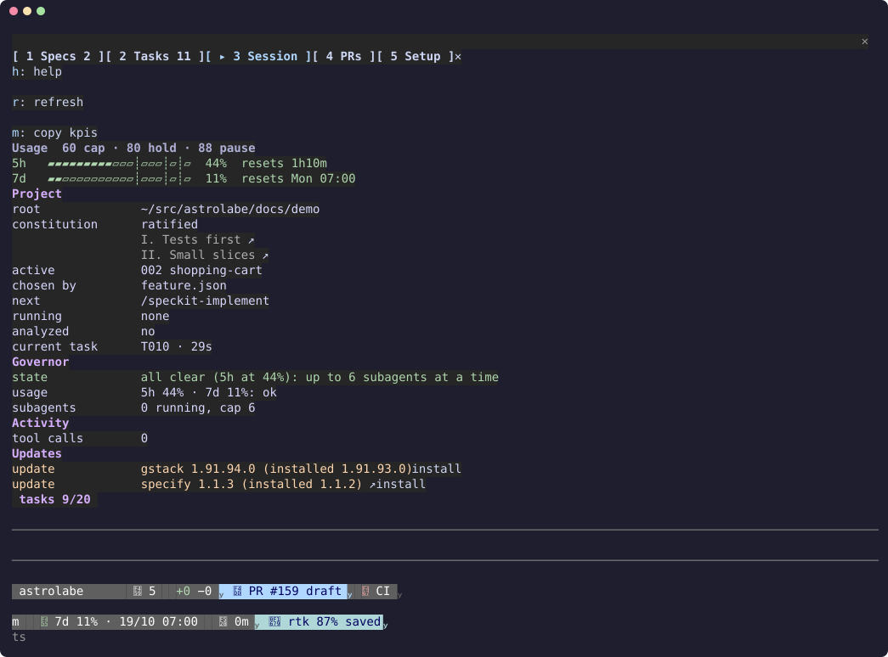

Features sit under section headers, in a fixed order: `Active`, `In progress`, `Early`
(specify and clarify), `Ready to close` (every task ticked while the front matter says
`active`), `Next up` (planned), `Done` and `Abandoned`. Every row has the same columns: id and
name, phase, a progress bar, the task count and the percent. A figure the files do not give
reads `?%` and `?`, never `0%`.

```text
Active (1)
▸ ◐ 002 band-hint   implement  ████░░░░░░   9/20  45%  ⟳ speckit-implement
Done (1)
  ● 001 core-state  done       ██████████  49/49 100%
```

#### A project of a hundred specs or more

With more than 12 specs the tab opens in **Focus**: a summary row (`64 specs`, a stacked bar and
`▶6 · 3 early · 6 to close · ✓49`), a checks row, then only the specs that need you (Active, In
progress, Early, Ready to close) and Done counted per block of 50 ids:

```text
64 specs ████████████████▓▓▒░░ ▶6 · 3 early · 6 to close · ✓49
▲ 3 checks · 028 done with 1/30 ticked · ids 029 and 030 used twice
Ready to close (6)
  ◐ 044 pane-navigation  implement  ██████████  12/12 100%
Done 49 ▸ 001–050 42 · 051–100 7
```

The height is the same at 64, 200 or 1000 specs. `v` shows **All**: every spec in blocks of
50 by id, each header `▾ 001–050 ✓42 ▶6 ·2 ▲3` (done, in progress, early, checks), opened and
folded with a press; the block that holds the active spec starts open. `g` (in All) cycles the
grouping: status, phase, track, priority. Typing `#05` in the filter jumps by id: a row shows
`# 05 → 050 051 … 059`, and Enter opens the block of the first one and selects it.

The checks row covers a spec marked `done` with open tasks, an id used twice (both folders stay,
each marked `▲ id×2`), a `feature.json` that is dangling or malformed, and files the plan names
that are not there. Each check also sits under its own spec. A spec Claude read or edited this
session shows under `Touched this session`. Specs not read yet (a large project reads the others
in batches) show as one row per run, `· 040–049 not read yet · reading in the background`. When
a list is longer than the pane, the filter row says `rows 12–40 of 140` and a `┃` thumb marks the
place on the right edge. The `✓ close` button on a ready spec offers the front-matter edit in the
prompt box; Astrolabe writes nothing to the project.

`▸` marks the active feature. `●` is done, `◐` in progress, and `○` abandoned (drawn dim). `?2` and `☐3` count a spec's open questions and open checklist items, and `↗` at the end of a row opens its `spec.md`; `plan↗` and `tasks↗` follow once those files exist (terminal only: the Desktop app does not open `file:` links). While a
Spec Kit skill runs, `⟳` and the skill's name follow the active feature. A narrow pane drops the
bar first, then the count, then cuts the name; the id always stays. If `.specify/feature.json`
names a done feature while the git branch names one that is not done, a `!` line says so and
gives the path to set. Under the list come the other warnings: a `~` line when the active feature was guessed because
`.specify/feature.json` is broken, a `!` line for a spec that still has
`[NEEDS CLARIFICATION` after its plan exists, a `?` line with how many markers a spec still has
before its plan, and a `☐` line with the open items of a feature's `checklists/*.md` until the
feature is done.

Above the list, a filter field keeps the features whose id or name holds what you type, and the
active feature's summary shows its title, its first paragraph and its user stories with their
priority, followed by links to its `spec.md`, `plan.md` and `tasks.md` (only the files that
exist). In the terminal a link opens the file with ctrl or cmd and a click, as your terminal
opens `file:` links.

The tabs follow Claude during a turn: a Write of `.specify/feature.json` or the constitution, a
Bash command that makes a spec or switches the branch, and a subagent's return all redraw them at
once, without waiting for the turn to end.

Where the row has room, its phase takes its colour on the rail (clarify and implement peach, plan blue, tasks mauve) and the bar its fill and empty colours. A spec's own warnings sit right under its row, the blocking ones first (a file that cannot be read, a missing `spec.md`). With no filter, Done and Abandoned past three features fold to their heading (`Done (12) · folded; s or is:done shows them`). The Help tab explains each gate. Under the active feature a dim `gates` row shows where it stands: `constitution ✓  clarify ✗2  checklist ✗3  tasks ✓  analyze –` (`✓` passed, `✗` with what is open, `–` not reached yet). A feature row names the worktrees working on it (`⑂ wt-a`), and its count takes the worktree's ticks when that worktree has more of the same task list done; one feature open in two worktrees gets a `!` line, since their changes will collide. `/astrolabe worktrees` lists every worktree and the feature it works on, as text. A worktree row also says how many files it has not committed (`· 3 uncommitted`) and, once its branch is merged into the main checkout's branch, `· merged · git worktree remove /path/to/it`. A folder under `specs/` with no `spec.md` gets a `?` line naming it.

When the repository has other git worktrees, the features they work on show under the list, read
after each turn from the branch name (`026-...`) and that worktree's files:

```text
⑂ astrolabe-dev  ◐ 026 claude-context  implement 3/5
```

**2 Tasks** lists the active feature's open tasks in file order, after a count. In the terminal each task ends with `↗`, a link to its line (`tasks.md#L42`, or `spec.md` for a quick spec):

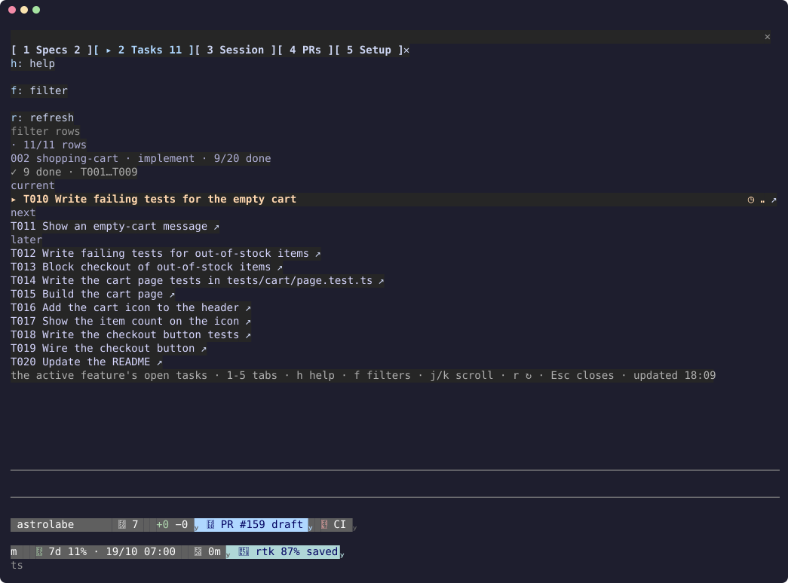

The task being worked on is marked `▸` and shows how long it has run (`▸ T010 Write x.ts                    ◷ 12m`): the row is bold and the clock sits at the right edge. The last turn's diff of `tasks.md` shows at most 6 lines and a `… +N lines` line. The first row names the feature, its phase and its count (`026 claude-context · implement · 9/20 done`). Ticked tasks fold into one dim row (`✓ 9 done · T001…T009`). Headings of `tasks.md`, such as `Phase 3: User Story 1 - Cart page`, head their tasks with their own count (`US1 Cart page 2/5`), and a run of `[P]` tasks is bracketed at the right edge with `┐ P`, `┤ P` and `┘ P` (a lone one gets `P`); the `can run in parallel` line shows only when no bracket does. After two done tasks the first row adds what is left at their pace (`≈1h20m left`). When the open tasks, at the time the ticked ones took, would end after the 5-hour window resets, a `▲` line says so. When more tasks are open than the pane has rows, the last line says `+N more`. A feature with
no `tasks.md` yet says so; a quick spec (`track: quick`) uses the `## Tasks` section of its
`spec.md` instead. When two or more `[P]` tasks come first among the open ones, a `⇉` line names
them: they can go to subagents at once. The `▶ send T002, T003 to subagents at once` button above
the list submits one prompt that asks Claude to dispatch each of them to its own subagent in one
message, with the plan and the files the task names, and to tick each when it is done.

Above the count, the last main turn's change to the task list shows as a diff: each box it
ticked or unticked, with its line number in the file. It stays until a later turn changes the
list again.

**3 Session** shows how Astrolabe sees the project right now, and any updates: Its rows sit under four headings: Project, Governor, Activity (summaries, reviews, advisor runs) and Updates. The Project block also shows the branch; in the terminal its `↗` opens the branch's page on the remote (`git remote get-url origin`, asked once a session). In the terminal, an update to Astrolabe or Spec Kit ends with `↗`, a link to that version's release notes. The governor's `state` row is green when all is clear, yellow while it slows down or holds, and red when paused.


`chosen by` is how the active feature was picked (`feature.json`, `branch` or `latest`).
`analyzed` says whether `/speckit-analyze` ran in this session on the current `tasks.md`. Ticking a task keeps it; adding, removing or rewording a task sets it back to `no` until analyze runs again. `hooks before` and `hooks after`
list the Spec Kit extension hooks (`.specify/extensions.yml`) around the next command. When that
file has a line Astrolabe cannot read, a red `extensions` row names it, for example
`.specify/extensions.yml line 3: not an event, an item or a key: value; its hooks are not read`.
A tab in the indentation and an unclosed quote are named the same way. In a
folder with several Spec Kit projects under it, `other roots` names them, and
`/astrolabe root <folder>` reads one of them as the session's project.

**4 Dashboard** puts the session in numbers and charts (from 100 columns the session's KPI rows sit two to a line):

- a first row of chips: tasks done, burn rate, context and where the deciding window lands at its reset (`tasks 9/20 │ burn 12/h │ context 61% │ 5h at reset 70%`), the burn and context chips green, yellow or red like the footer;
- an astrolabe dial with the six Spec Kit steps around a ring, the active feature's step marked
  `●` with the needle on it, earlier steps ticked `✓`;
- the active feature's tasks done out of all of them;
- one bar per phase with how many features are in it;
- a line chart of the deciding usage window over the session, 0 to 100%, with a dotted
  projection to the reset at the current burn rate, and a legend under it that says what `●`,
  `│` and `·` mean;
- the session's counts (drift alarms and subagents appear once there is one): turns, tool calls, drift alarms (with the features they came from, `3 (002: 2, 004: 1)`), subagents run and queued, context, tasks an hour, turns a task (to see when Claude spins), context a task (the window points each ticked task used, the ones compactions freed included), compactions and the context they freed, how long work waited on the governor,
  duration, burn rate in points an hour, and where the window should be at the reset;
- a sparkline each for the 5-hour window, the weekly window and the context over the last readings;
- the slowest task of the active feature, an estimate for its open tasks from the time the ticked
  ones took, and the tasks and features finished this week, across sessions, with a block per weekday for
  the tasks ticked on it (`▂▅█▁    M T W T F S S`), and once more than one week has some, the tasks
  done in each of the last 8 weeks (`▁▃▂▅▄▆▇█  12 this week`).

A turn that ticked tasks says so next to its duration (`Baked for 1m 1s · 2 tasks done`). The
Session tab shows the governor's steps of the day (at most 10): what it asked, what you answered, and when it
resumed.
Under its `constitution` row the Session tab lists each principle of a ratified constitution (the
`###` headings under `## Core Principles`), and each one opens `constitution.md` at its heading.

The dial sweeps its needle from the first step to the active one when the tab opens, then
holds still. On kitty and Ghostty (outside tmux) the usage chart is a picture, with dashed
lines for the projection; the `images` option turns that `on` for other terminals that show
pictures (iTerm2, WezTerm) or `off`.

In the terminal the charts are drawn cell by cell in the theme's colors; in the Desktop app and
VS Code they are vector images; with `icons: ascii`, or where neither is drawn, they are plain
text. A pane too narrow for a chart shows its numbers instead. Drawing reads only what the
session already holds, never a file.

A tab longer than the pane scrolls inside it while the footer stays on the last rows. A
`▲ 3 more (k)` or `▼ 12 more (j)` row says what is hidden; press it, or `k` and `j` while the
pane has the keyboard, or use the wheel and the arrow keys. The Dashboard scrolls by whole
sections, so a chart is never cut in half.

**5 Help** lists the `/astrolabe` commands, the pane and band keys, and the options, in your
language. Each `/astrolabe` command ends with a `⧉` button that copies the command (`/astrolabe
focus`, without its optional `[on|off]`) and says so in a toast. A Health block at the end holds the
checks of `/astrolabe doctor`, read when the tab opens and at most once a minute.

**6 Config** lists every Astrolabe option as `/config` holds it, under four headings (Display, Governor, Claude, Integrations), with a control for each: a picker
for a choice, a toggle for on and off, a field for a number or a text. A changed row is marked `●`.
`Save N changes` applies them through Claude Code's settings, and Astrolabe reloads with the new
values; `Cancel` drops them. A row your organization's policy locks shows its value and cannot be
changed; `•` marks an option saved with a value other than its default. `Reset to defaults` puts every option back to its default as a draft that Save applies; `/astrolabe config reset`, typed by you, does it at once.

**7 PRs** starts, when gstack is installed and the branch is not `main`, with `▶ gstack /ship for <branch>`, which runs gstack's `/ship` on it. When a `gh pr create` in the session prints the new PR's URL, a toast offers gstack's `/review` on it (`🧭 PR #128 opened: run gstack /review on it before the merge`). It lists the repository's open pull requests, read with `gh` when the tab opens and at most
every two minutes after a turn while it is shown. Each row links to the pull request and shows its
checks (`✓` passed, `✗` failed, `…` running), its review state, its labels and its branch. In the
terminal a third line links each check to its run page, six at most (`✓ test (macos)`). The
buttons GitHub would allow sit beside it: `Approve`, `Update branch` when the branch is behind its
base, and `Merge` when it is ready. When `gh pr list` fails or does not answer in 8 s, the tab says why and names `gh auth status`. Each asks for a second press before it runs: the button reads `Press again to merge #42`, and after 10 s without it the button asks again from scratch. A merge waits for green checks.

With the `full` preset, the pane also opens by itself once per session, at the end of the
first turn, but only in a fullscreen terminal at least 144 columns wide. It never opens by
itself on a narrower or non-fullscreen terminal.

## What Claude is told

With `claudeContext` on (the default), Claude reads one line about the Spec Kit work next to your
prompt, and only when it changed since the last one:

```text
Astrolabe: the active Spec Kit feature is 002 band-hint, phase implement, 9 of 20 tasks done; the current task is T010 task 10; the next command is /speckit-implement.
```

The line rides on the message, not in the system prompt, so the prompt cache stays whole. When a
Spec Kit skill runs, Claude also gets the constitution's Core Principles by name as a reminder to
check the step against them. When the governor resumes paused work, its prompt says where the work
stopped (`The work stopped at T010 task 10 in 002 band-hint.`).

`/astrolabe ask <question>` asks Claude about the active feature without a turn: the question goes
to a fork of the session (the same context, served from the cache, no tools) and the answer shows
in a toast.

## Toasts

Astrolabe raises short notices in Claude Code's toast area. Each marks a change, never a
turn, so they stay rare. The drift alarm and the phase toast follow the preset; the usage
notices at the end of this section show in every preset.

**Drift alarm** (presets `compact` and `full`). When Claude ticks a task in `tasks.md` but no
code file was edited in the turn, you see (captured after asking Claude to tick T010 and do
nothing else):

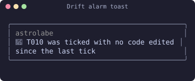

If the task names files, at least one of them has to have been edited, or the toast lists them:

```text
astrolabe ▲ T014 was ticked, but none of its files were edited: tests/core/parser.test.ts
```

A task about tests that names no file, ticked while code changed but no test file did, raises
one too:

```text
astrolabe ▲ T009 was ticked, but no test file changed
```

A code file is any file inside the Spec Kit root that is not under `specs/` or `.specify/`,
edited with Edit, Write or NotebookEdit, by Claude or by a subagent. The check covers one turn:
any code edit in the turn covers every tick in it, and a turn raises the alarm at most once. It
stays quiet when a Bash or Agent call happened in the turn, because the mod cannot see what
those changed. A box you tick in your own editor never raises it.

Two limits to know: edits outside the Spec Kit root (code beside a nested `.specify/` in a
monorepo) are not seen, and in a batch of parallel tool calls a tick that runs before its code
edit raises the alarm.

**Phase toast** (preset `full` only). When the files on disk show that a feature moved to a
later phase, you see it once per session:

```text
astrolabe ✓ 002 band-hint moved to tasks · next: /speckit-tasks
astrolabe ✓ 002 band-hint is done · next: /speckit-specify
```

To decide what is new, Astrolabe remembers each feature's last seen phase for the session.
The first check of a session only records the phases, so a change made between sessions does
not toast, and two sessions open on the same project each toast on their own. A Spec Kit skill that starts never toasts by itself; only the files count.

To turn the toasts off, pick the `minimal` preset, or `compact` to keep only the drift alarm.

When three turns in a row work on the same task and tick nothing, a toast says so once: `astrolabe ▲ three turns on T010 and nothing ticked: /compact, or split T010 into smaller tasks`. With `claudeContext` on, the line Claude reads also names what still blocks the feature: open `[NEEDS CLARIFICATION]` markers, open checklist items, and `/speckit-analyze` not yet run before the first task. A prompt that names another feature by its id (`fix the bug in 001`) also gets a line saying which feature is active, since `.specify/feature.json` decides what Spec Kit skills work on.

The first `/speckit-implement` on a feature whose `spec.md` still has `[NEEDS CLARIFICATION` markers is refused. Claude reads why: `Astrolabe: feature 001 auth still has 1 open [NEEDS CLARIFICATION] marker in spec.md. Run /speckit-clarify first. To implement anyway, call /speckit-implement again.` A second call in the same session goes through.

**Usage notices.** Each shows once a session:

```text
astrolabe ▲ The context window is 86% full: /compact before Claude Code compacts it for you
astrolabe ▲ The prompt cache goes cold in about 30 s: the next prompt after that re-reads the whole context
```

The context line shows at 85%, and once more
after the context drops below 70% (a `/compact`) and climbs back. The cache line shows 4.5
minutes after a turn ends with no newer turn, since Claude Code's prompt cache lasts 5 minutes.

When the governor resumes queued work after a window resets, it also sends a phone notice
through Claude Code's push notifications, if you have them on. Claude Code skips it while you
are at the terminal.

## Update notices

Once a day, the first time a session starts or a turn ends on a new day, Astrolabe checks four
things in the background and adds a row of buttons under the band for anything that has a
newer version:

```text
updates: [ gstack 1.91.33.0 ][ specify 1.2.0 ][ Spec Kit skills 1.2.0 ][ astrolabe 0.8.0 ]
```

| Button | How Astrolabe knows | What a click does |
|---|---|---|
| gstack | `~/.claude/skills/gstack/bin/gstack-update-check` exists and reports `UPGRADE_AVAILABLE` (Astrolabe reads `HOME`, or `USERPROFILE` on Windows, to find it, and runs nothing when gstack is not installed) | Runs the `/gstack-upgrade` command, which upgrades gstack and reports itself. |
| specify | `specify self check` names a newer release | Runs `specify self upgrade`, then toasts `astrolabe ✓ specify updated to 1.2.0`. |
| Spec Kit skills | `specify version` is newer than this project's `.specify/integrations/speckit.manifest.json` | The first click turns the button into `confirm: rewrite .claude/skills/speckit-*`. The second runs `specify init --here --integration claude --force` in the project, which rewrites the project's Spec Kit skills. |
| astrolabe | GitHub's latest release of jonyfs/astrolabe is newer than the installed version | Runs `claude plugin update astrolabe`, then toasts that you should run `/reload-plugins`. |

On a narrow terminal the row keeps the buttons that fit and ends with `+N` for the rest. The
last button, `hide`, dismisses every update shown; each one comes back only when a newer version
than the hidden one appears. A button disappears once its update succeeds. When one fails, a toast gives the first error
line and the command to run yourself. A tool that is not installed is simply skipped.

This is the one network call Astrolabe makes: a single request a day to
`https://api.github.com/repos/jonyfs/astrolabe/releases/latest`. The results are kept in the
mod's store with the date, so other sessions the same day show them without checking again.
With the `minimal` preset there is no band, so the updates are listed in the `/astrolabe` pane's
Session tab instead (without buttons). To turn the checks off, set `checkUpdates` to `false`;
then Astrolabe runs no process and makes no network call.

## What Astrolabe reads

Only files inside the Spec Kit root, the nearest folder above the session's directory that
holds `.specify/`. It never writes a project file. It runs processes and makes one network call
only for the daily update check (see [Update notices](#update-notices)), and only when you
click a button does anything get installed. Its own store (the plugin's JSON file under your
Claude Code configuration folder) keeps only the last update check, the updates you hid, and the
tasks and features finished per week (the last 12 weeks).

| File | Used for |
|---|---|
| `.specify/feature.json` (`feature_directory`) | The active feature, when it names an existing `specs/NNN-name/` folder. |
| `.specify/memory/constitution.md` | Whether the constitution is missing, still the template (it contains placeholders like `[PROJECT_NAME]`), or ratified. |
| `specs/NNN-name/spec.md` | The front matter and any `[NEEDS CLARIFICATION` markers. |
| `specs/NNN-name/plan.md` | Only whether it exists. |
| `specs/NNN-name/tasks.md` | The tasks. |
| `.git/HEAD` (or the `gitdir:` file of a worktree) | The current branch, read as a file. |

A `spec.md` or `tasks.md` that exists but cannot be read (its permissions, or a lock another
program holds) shows in the `/astrolabe` pane as `! 002: tasks.md exists but could not be read`,
and Astrolabe tries it again every turn until a read works. If the session read the file
before, Astrolabe keeps that text, so the phase does not jump back. A constitution that cannot
be read also keeps its last text, without a pane row.

### Large projects

Past 150 features, a session start reads the active feature (from `feature.json` or the branch) and
the twenty newest at once, so the band draws right away, and reads the others in batches of 100
right after. Until its batch lands, the Specs tab shows one row for the run (`· 040–049 not read yet`).

### Which feature is active

1. `.specify/feature.json`, when its `feature_directory` names a folder under `specs/`
   that exists. Relative, absolute and Windows spellings all work.
2. Otherwise the git branch, when it is named like a feature folder (`002-band-hint`) and
   that folder exists.
3. Otherwise the highest-numbered feature that is neither done nor abandoned.

Spec Kit's `SPECIFY_FEATURE` and `SPECIFY_FEATURE_DIRECTORY` environment variables are
ignored: they are set in the shells Claude runs, not in Claude Code itself. Use `feature.json`
or the branch. The only environment variables Astrolabe reads are `HOME` and `USERPROFILE`, to
find gstack for the update check.

### Tasks

A task is a line that starts with `-` or `*`, a space and a checkbox: `- [ ]`, `- [x]` or
`- [X]`. Both `x` and `X` count as done (`/speckit-implement` writes `[X]`). Indented
checkboxes count. Lines inside fenced code blocks do not.

```markdown
- [X] T001 Create the manifests
- [ ] T002 [P] [US1] Write the parser tests
  - [ ] T003 Nested tasks count too
- [ ] fix the typo        <- ignored: this file has task ids, and this line has none
```

When any task in the file carries an id (`T001`), lines without one are skipped, so a
stray checklist in the same file does not change the count.

### Front matter

A spec can say what it is instead of letting Astrolabe guess. Put this at the very top of
`spec.md`:

```yaml
---
track: full    # quick | full
status: active # active | done | abandoned
---
```

`status: done` and `status: abandoned` win over every other rule. `track: quick` keeps a
spec with no plan or tasks in `implement`. This repository's spec template already adds the
block to new specs.

## Usage governance

Claude Code tells the mod how full your 5-hour and weekly windows are after every turn.
Astrolabe adds the window that decides to the status entry and acts on it:

```text
⚠ astrolabe: ◆ 002 · implement 45% │ 5h 42%
⚠ astrolabe: ◆ 002 · implement 45% │ 5h 83%▴ hold
```

| Band | Window | New subagents (`Agent` calls) | Other tools |
|---|---|---|---|
| ok | below 60% | up to 6 at once | run |
| throttle | 60% to 80%, or a burn rate that would reach 80% before the reset | 3 at once below 70%, then 1 | run |
| hold | 80% or more, and down to 75% in the window that reached 80% | you are asked; by default refused and queued | run |
| stop | 88% or more | refused and queued | you are asked; by default only read-only tools (Read, Grep, Glob, LS, WebFetch, WebSearch, TodoWrite, Skill) |
| ceiling | 90% or more | refused and queued | you are asked; by default only read-only tools |

Each window is banded on its own and the one in the highest band decides, then the fuller one.
Once a window reaches 80%, it stays in hold until it falls below 75%, so usage that moves around
80% does not hold and release subagents again and again. When a window's reset time passes,
Astrolabe does not know the new percentage until Claude Code sends the next reading: the status
entry says `5h renewed` and subagents run one at a time until then.

A refused call tells Claude why and when the window resets, for example
`🧭 usage 5h 83% (hold): new subagents are queued until 14:00; queued as q1`. When the window
resets, or a new reading takes it out of hold, Astrolabe sends one prompt that lists the queued
subagents so Claude dispatches them again, and a paused session continues. A running subagent
is never stopped. The cap counts subagents running in the foreground; one started in the
background returns at once and is not counted. At most 20 subagents wait; past that, a refused
one is not queued and Claude is told to dispatch it again after the reset.

The Session tab says where the governor stands in plain words, for example
`holding (7d at 83%): new subagents wait until 14:00; other tools run`, and, at the pace of the
recent readings, when the next band comes (`hold at 80% in about 30m at this pace`). It lists
each queued subagent with the command that sends it now: type `/astrolabe run q1` yourself
(Claude, a plugin or a script cannot). The queue survives `/reload-plugins` and a new session: when one starts with subagents still waiting, a toast says so, for example `astrolabe ✓ 2 subagents still waiting since 14:02; /astrolabe run <id> runs one now`. While the session is paused, the footer's first chip turns
red and says until when: `5h 92%▴ ceiling · paused until 14:00`.

Only you can lift stop and the ceiling, by typing the command yourself (a command sent by
Claude, a plugin or a script is refused):

```text
/astrolabe allow 95 2h
/astrolabe revoke
```

`allow` takes a target from 90 to 99 and a duration from `30m` to `12h`; it lasts until the
duration ends or the window resets. It lifts only the window that decided when you typed it, so
lifting the weekly window leaves the 5-hour window's stop and ceiling where they were. It does
not lift the hold at 80%; the question below can.

### Asked when it holds or pauses

When the governor queues a subagent at hold, or refuses one of Claude's tools at stop or the
ceiling, it refuses at once with the cautious answer and then asks you. Claude Code gives a hook
10 seconds, so the governor never makes Claude wait for you: Claude is told that you are being
asked and not to retry. The question opens in a pane with the keyboard on it. The arrows move
between the answers, Enter picks one, and the first answer, the cautious one, is already
selected:

```text
‖ 7d at 83%▴ · "Full review" is queued until Mon 07:00
❯ Keep it queued (applied)
  Run it now
  Lift holds for 1 hour
  Drop this request
The cautious default is already applied. ↑↓ to choose, Enter to pick; Esc or no answer keeps it.
```

What each answer does:

| Answer | What happens |
|---|---|
| `Keep it queued (applied)` | The subagent stays queued until the window resets. |
| `Run it now` | It leaves the queue, and a prompt tells Claude to send it again; that one call goes through. |
| `Lift holds for 1 hour` | The queue is sent again, and new subagents run one at a time for the hour. |
| `Drop this request` | It leaves the queue; later subagents are dropped too while the band lasts. |
| `Keep it paused until <reset> (applied)` | Claude stays paused until the window resets. |
| `Continue for 30 more minutes (ceiling 91%)` | The ceiling is raised for 30 minutes, and a prompt tells Claude to continue. |
| `Raise the ceiling to 95% for 2 hours` | The same, for 2 hours. |

Each ceiling is at least two points above current usage and at most 99%. An answer that cannot
raise the ceiling above current usage is left out. A prompt Astrolabe sends waits until Claude's
current turn ends.

If you do not answer within a minute, or you press Esc, the pane closes and the first answer
stands. The governor keeps that answer, and `Drop this request`, while the band lasts, so it does
not ask again for every call; it asks again once usage leaves the band and comes back. Only one
question is open at a time. Calls that arrive meanwhile are refused with the cautious answer too,
and the answer you pick covers them through the queue.

The pane needs 144 columns when nobody asked for it. On a narrower terminal the question shows
in Claude Code's own question dialog instead. That dialog stays open until you answer it, and
the answer applies whenever you give it.

Claude cannot pick an answer: it comes from your key press. Hooks and plugins you installed run
with your trust, though, and one that answers Claude Code's question dialog (a `PreToolUse` hook
on `AskUserQuestion`) could answer the narrow-terminal question for you. A session with no one at
the prompt (`claude -p`, the SDK) is never asked. A running subagent is never asked about and
never stopped. To turn the questions off, set `askOnLimit` to `false`.

`governUsage` and `askOnLimit` are plugin options. Anything that can run `claude plugin
configure` can change them, including Claude through Bash when you allow that command, so
review such a call before you approve it.

Off a subscription (an API key) there are no windows, so nothing is shown or refused. To keep
the readings but turn the governing off, set `governUsage` to `false`. If this project also
has the usage-governor skill's hooks installed, they govern too; keep one of the two.

The `/astrolabe` pane's Session tab shows the governor: the windows and the band, the subagents
running against the cap, the queue, an override and a lift with the time each one ends:

```text
usage         5h 42% · 7d 83%▴: hold
subagents     0 running, cap 0
queue         1 waiting: q1 Full review
override      ceiling 95% on 7d until 14:00
```

Astrolabe has the usage-governor skill's bands, caps, burn-rate projection, hysteresis,
per-window overrides, queue and resume, and it asks before it holds or pauses. It leaves out what
does not fit a mod:

- thresholds in a config file: the mod's options are plugin options, which anything that can run
  `claude plugin configure` can change;
- its own `/usage` probe: Claude Code sends the windows after every turn;
- a ramp for the queue after a reset: one subagent at a time until the next reading does that;
- a command line, an audit log, and Codex and Copilot.

## Where it works

| Surface | Draws |
|---|---|
| Terminal on Linux, macOS and Windows (Claude Code 2.1.287 or later) | Yes |
| Claude Desktop app, Code tab (2.1.286 or later) | Partly. Claude Code raises the band, the spinner and the pane there, and the status entry and toasts reach it, drawn with the app's own look. The prompt hint's `next:` text is not shown: Claude Code draws that part only in the terminal for now. Every image in this README comes from the terminal; none was captured in the app yet. |
| VS Code extension, `claude -p`, cloud sessions | No. The mod's hooks run but nothing is drawn, and nothing errors. |

CI runs the tests on Ubuntu, macOS and Windows for every pull request.

Astrolabe replaces jonyfs/statusline. It does not set `statusLine`, so if you still have a
classic status line command configured, both show. When `~/.claude/settings.json` sets a
`statusLine` command that runs statusline, the first session toasts once how to pick who draws
the footer. `/astrolabe footer astrolabe` keeps Astrolabe's footer and `/astrolabe footer statusline`
leaves it to statusline, so Astrolabe stops drawing its status entry from the next session.
`/astrolabe footer` alone says which one is set. The pick is kept across sessions and Astrolabe
never asks again; only you can change it, from the prompt.

## Troubleshooting

- **Nothing appears.** Check `claude --version` (2.1.292 or later) and
  `claude plugin list` (`astrolabe@astrolabe`, enabled). Mods draw only in the terminal and
  the Desktop app's Code tab.
- **The wrong feature shows, or a `~`.** Open `.specify/feature.json`. Its
  `feature_directory` must name a folder under `specs/` that exists, for example
  `"specs/002-band-hint"`.
- **A tick does not show.** The entry follows the disk at the end of each turn. Send any
  prompt and wait for the turn to end.
- **See what the mod did.** Run `claude --debug`. Any error Astrolabe caught is written to the
  debug log as a line starting with `astrolabe:`. While a plugin folder is hot-reloaded, the
  transcript also shows a dim line when a hook was skipped.

## From a statusline to a mod

[docs/tutorial/README.md](docs/tutorial/README.md) teaches, in eight steps, how to turn a
classic `statusLine` command into a mod, with jonyfs/statusline as the worked example and this
repository as the result. Each step pairs the file in one with the file in the other.

## Development

```sh
claude plugin validate .
claude plugin test .
sh scripts/fetch-engine-types.sh          # once: the engine's declarations for the type check
npx -p typescript@5 tsc -p .
sh scripts/check-readme-sync.sh          # the README against the version, the options and the commands
```

The type check needs the declarations Claude Code writes for mods. They are not part of the
plugin and are not committed: `scripts/fetch-engine-types.sh` downloads them into
`types/engine/` from this repository's `engine-types-2.1.292` pre-release, and CI does the
same. After a Claude Code update, `scripts/sync-engine-types.sh` copies the new declarations
from your machine and prints the `gh release create` line that publishes them.

### Benchmarks

`npm run benchmark` measures the mod's performance and compares it against a baseline:

```sh
npm run benchmark -- --output results/benchmark.json            # run and save the raw result
npm run benchmark -- --baseline baseline.json --threshold 10    # fail on a regression past 10%
npm run benchmark -- --save-baseline --baseline baseline.json   # adopt this run as the baseline
```

The report covers duration, peak memory, CPU and any custom metrics, with a per-metric
comparison (`regression`, `improvement` or within the threshold). The command exits nonzero
when a regression passes the threshold, so CI can gate on it. On every pull request the
benchmark job in [.github/workflows/ci.yml](.github/workflows/ci.yml) runs the suite and
comments a table on the PR with each metric's current value, baseline and delta.

### Generating README images

`npm run generate-images` renders the source diagrams under `docs/diagrams/` into
`docs/images/` (PNG and SVG; WebP where the renderer supports it), for both Mermaid diagrams
and anything that needs a browser capture, through
[mermaid-cli](https://github.com/mermaid-js/mermaid-cli) and Playwright:

```sh
npm run generate-images                     # only changed sources
npm run generate-images -- --no-only-changed
```

A `manifest.json` in `docs/images/` records source, output and format for each image, so a
second run regenerates only what changed. The generate-images job in the CI workflow runs it
on every push and commits the results with `[skip ci]`, so committed images always match their
sources.

### Desktop app captures

`npm run capture` drives the packaged desktop app with Playwright and captures the views
listed in [config/capture-views.json](config/capture-views.json), one artifact per view:

```sh
npm run capture -- --app dist/app --output-dir docs/assets/captures
```

Each view names a URL, optional actions (`click`, `type`, `wait`, `scroll`) and a capture:
a `screenshot` with a viewport (and an optional element selector) or a `video` with a
duration. The capture workflow
([.github/workflows/capture.yml](.github/workflows/capture.yml)) runs weekly and on demand
and uploads `docs/assets/captures/` as a build artifact.

### Privacy policy

[docs/privacy.md](docs/privacy.md) is generated, never hand-edited:

```sh
npm run generate-privacy -- --config config/privacy.config.json --output docs/privacy.md
```

The configuration in [config/privacy.config.json](config/privacy.config.json) declares what
the mod reads, stores and sends; validation fails the build when a section required by the
declared jurisdictions (GDPR and CCPA by default) is missing.

### Marketplace plugin assets

`npm run build-assets` turns the source files in `docs/assets/source/` (`logo.png`,
`banner.png` and screenshots) into every size each marketplace asks for, under
`docs/assets/marketplace/<marketplace>/`:

```sh
npm run build-assets                                   # vscode, jetbrains and chrome specs
npm run build-assets -- --marketplaces vscode
```

The per-marketplace sizes and formats live in `src/plugin-assets/specs.ts`. Missing or
mis-sized sources fail validation, and the built tree is git-ignored: it is regenerated on
demand, so `docs/assets/source/` is the only copy to keep.

### Load tests

`npm run load-test` measures how the mod holds up against a project with hundreds of
synthetic Spec Kit features:

```sh
npm run load-test                                     # 500 features, 30% simple / 50% medium / 20% complex
npm run load-test 1000 -- -d 0.5,0.4,0.1 --parallel   # custom count and distribution
npm run load-test -- --memory-limit 512 --output-dir results
```

The distribution shares must sum to 1. Each feature has a per-feature timeout and the run a
memory limit; a failure of either fails the run with a nonzero exit. The report (also saved
as `results/load-test-*.json`) gives throughput and the slowest features. The load-test job
runs weekly and on demand and keeps the report for 90 days.

### Releasing

A release comes only from a tag `vX.Y.Z` equal to `plugin.json`'s `version`. Bump the version
in a pull request, merge it, then tag `main`:

```sh
sh scripts/check-release-version.sh v0.6.0   # the same check the release workflow runs
git tag -a v0.6.0 -m "Astrolabe v0.6.0"
git push origin v0.6.0
```

The release workflow checks the tag against `plugin.json`, runs validation, tests, the type
check and the README guard again on Ubuntu, macOS and Windows, and creates the GitHub release
with generated notes.
A tag that does not match never produces a release.

Installs follow `main`: the repository is its own marketplace, and `main` changes only through
reviewed pull requests and tagged releases.

### Process

Every change starts as a Spec Kit feature under `specs/` and goes through
`/speckit-specify`, `/speckit-clarify`, `/speckit-plan`, `/speckit-tasks`,
`/speckit-analyze` and `/speckit-implement`, test first. The rules are in
[.specify/memory/constitution.md](.specify/memory/constitution.md). Everything in this
repository is written in English.

## README summaries

### Português (pt-BR)

Astrolabe é um mod para o Claude Code que mostra o progresso do seu trabalho no Spec Kit e mantém a sessão dentro dos limites de uso: uma barra de fase acima do prompt, o próximo comando a executar, a tarefa em andamento, um painel com todas as features, toasts quando algo muda, botões que instalam atualizações, e uma entrada de status com sua janela de uso mais cheia.

**Instalação**: `/plugin install astrolabe --marketplace jonyfs/astrolabe` no Claude Code 2.1.292+.

**O que desenha**: barra (acima do prompt), entrada de status (abaixo do prompt), hint do próximo comando, spinner narrado, painel `/astrolabe` com abas Specs/Tasks/Session/Dashboard/Help/Config/PRs, toasts de drift/phase/uso, governança de uso (queue/hold/pause de subagents).

**Opções principais** (21 opções via `/config`): `preset` (minimal/compact/full), `flavor` (mocha/frappe/macchiato/latte/colorblind/theme), `language` (auto/en/pt-BR/es/fr), `governUsage`, `skillModels` (auto), `terse` (off/lite/full), `humanize`, `accessible`, `footerIn`, `bandDensity`, `checkUpdates`, `pullRequest`, `images`, `autoReload`.

**Governança de uso**: janelas 5h e 7d; em 80% faz hold (subagents esperam), em 88% para, em 90% teto; override temporário via `/astrolabe allow`, revogar com `/astrolabe revoke`.

**Comandos**: `/astrolabe` (abre painel), `help`, `next`, `status`, `ask`, `root`, `allow`, `revoke`, `run`, `doctor`, `priority`, `review`, `advisor`, `config reset`, `worktrees`, `recap`, `kpis`, `focus`.

### Español (es)

Astrolabe es un mod para Claude Code que muestra el progreso de tu trabajo en Spec Kit y mantiene la sesión dentro de los límites de uso: una barra de fase sobre el prompt, el próximo comando a ejecutar, la tarea en curso, un panel con todas las features, toasts cuando algo cambia, botones que instalan actualizaciones, y una entrada de estado con tu ventana de uso más llena.

**Instalación**: `/plugin install astrolabe --marketplace jonyfs/astrolabe` en Claude Code 2.1.292+.

**Qué dibuja**: banda (sobre el prompt), entrada de estado (bajo el prompt), hint del próximo comando, spinner narrado, panel `/astrolabe` con pestañas Specs/Tasks/Session/Dashboard/Help/Config/PRs, toasts de drift/phase/uso, gobernanza de uso (cola/hold/pausa de subagents).

**Opciones principales** (21 opciones via `/config`): `preset` (minimal/compact/full), `flavor` (mocha/frappe/macchiato/latte/colorblind/theme), `language` (auto/en/pt-BR/es/fr), `governUsage`, `skillModels` (auto), `terse` (off/lite/full), `humanize`, `accessible`, `footerIn`, `bandDensity`, `checkUpdates`, `pullRequest`, `images`, `autoReload`.

**Gobernanza de uso**: ventanas 5h y 7d; al 80% hold (subagents esperan), al 88% stop, al 90% techo; override temporal via `/astrolabe allow`, revocar con `/astrolabe revoke`.

**Comandos**: `/astrolabe` (abre panel), `help`, `next`, `status`, `ask`, `root`, `allow`, `revoke`, `run`, `doctor`, `priority`, `review`, `advisor`, `config reset`, `worktrees`, `recap`, `kpis`, `focus`.

### Français (fr)

Astrolabe est un mod pour Claude Code qui montre la progression de votre travail Spec Kit et garde la session dans ses limites d'utilisation : une barre de phase au-dessus du prompt, la prochaine commande à lancer, la tâche en cours, un panneau avec toutes les features, des toasts quand quelque chose change, des boutons qui installent les mises à jour, et une entrée de statut avec votre fenêtre d'usage la plus remplie.

**Installation**: `/plugin install astrolabe --marketplace jonyfs/astrolabe` dans Claude Code 2.1.292+.

**Ce qu'il dessine**: bande (au-dessus du prompt), entrée de statut (sous le prompt), hint de la prochaine commande, spinner narré, panneau `/astrolabe` avec onglets Specs/Tasks/Session/Dashboard/Help/Config/PRs, toasts drift/phase/usage, gouvernance d'usage (file/hold/pause des sous-agents).

**Options principales** (21 options via `/config`): `preset` (minimal/compact/full), `flavor` (mocha/frappe/macchiato/latte/colorblind/theme), `language` (auto/en/pt-BR/es/fr), `governUsage`, `skillModels` (auto), `terse` (off/lite/full), `humanize`, `accessible`, `footerIn`, `bandDensity`, `checkUpdates`, `pullRequest`, `images`, `autoReload`.

**Gouvernance d'usage**: fenêtres 5h et 7j; à 80% hold (sous-agents attendent), à 88% stop, à 90% plafond; override temporaire via `/astrolabe allow`, révoquer avec `/astrolabe revoke`.

**Commandes**: `/astrolabe` (ouvre le panneau), `help`, `next`, `status`, `ask`, `root`, `allow`, `revoke`, `run`, `doctor`, `priority`, `review`, `advisor`, `config reset`, `worktrees`, `recap`, `kpis`, `focus`.

## How the images are made

Every image is a real capture, never a drawing (Constitution Principle II):

```sh
scripts/capture/scene.sh overview-180 180 40 "$PWD/docs/demo" 30          # start claude in tmux, wait, capture
node scripts/capture/ansi-to-svg.mjs docs/images/overview-180.ansi docs/images/overview-180.svg --from "^◆ "
```

`scene.sh` starts `claude` in a tmux window of the given size, sends the keys you list (for
example `"/astrolabe" Enter 3 "keys:2"` to open the pane and show the Tasks tab), and saves
the screen with its colors. `ansi-to-svg.mjs` turns that into an SVG; `--from`, `--drop`,
`--crop` and `--cut` select the part to show. Inside tmux Claude Code draws with 256 colors,
so the images show the nearest match of each Catppuccin color. Lines from other status
providers (the author's own statusLine) and Claude Code's own usage notice are dropped, and
`--replace` shortens the author's home path to `~/src/astrolabe`; nothing else is edited.

`scripts/capture/flavors.sh` captures the overview and the Specs tab in mocha and latte, and the
overview in frappe, macchiato and colorblind. It sets the `flavor` option while it runs and
restores the previous value when it ends.

## Privacy

Astrolabe has no server and no telemetry. [docs/privacy.md](docs/privacy.md) lists every file it reads, what it keeps in Claude Code's store, and the one request it sends (the daily update check).

## License

MIT. See [LICENSE](LICENSE).
